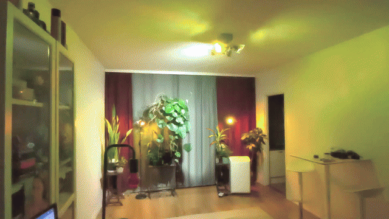
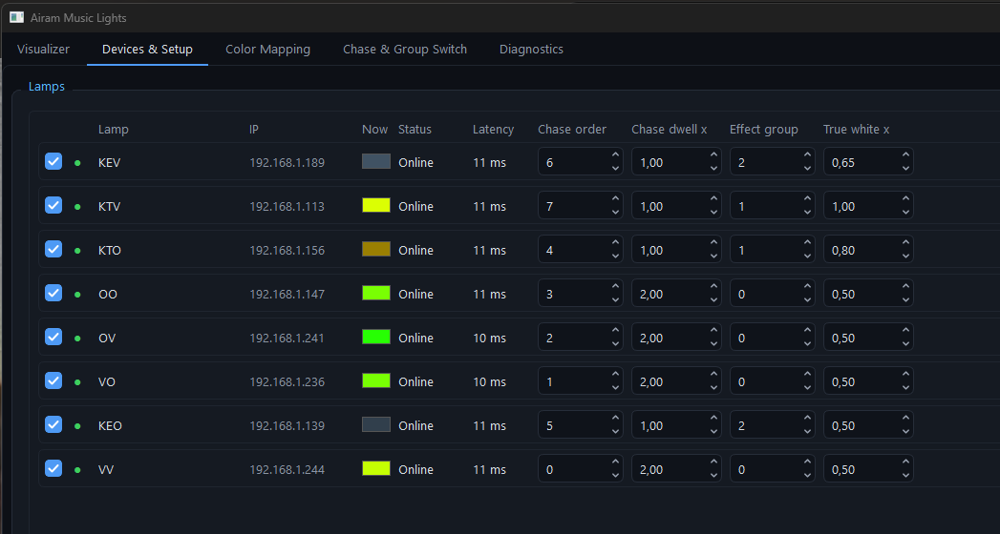

# Airam Music Lights


A real-time music light show for **Airam SmartHome Smart PAR16 RGB GU10** Wi-Fi spotlights:
every lamp at once and in sync, controlled over your **local network** - no cloud at
runtime, no phone app. Windows (ready-made build) and Linux (from source).

**[Download for Windows](https://github.com/juhaj77/tuya-music-sync/releases/latest)** ·
[Quick start](#quick-start) · [Suomeksi](#suomeksi) · [Demo videos](#demo-videos) ·
[Troubleshooting](#troubleshooting)

## Contents

- **[Quick start](#quick-start)** - from download to a running show in six steps
- [What it does](#what-it-does) · [Suomeksi](#suomeksi) · [Demo videos](#demo-videos)
- **Getting started**
  - [Installation](#installation) - Windows build, or from source on Windows / Linux
  - [Getting the lamps' local keys](#getting-the-lamps-local-keys)
  - [Testing one lamp](#testing-one-lamp)
- **User manual**
  - [The window](#the-window) - tabs, collapsible sections, greyed-out settings
  - [Visualizer tab](#visualizer-tab) - audio, mode, Quick Controls
  - [Devices & Setup tab](#devices--setup-tab) - lamps and their place in the effects
  - [Color Mapping tab](#color-mapping-tab)
    - [Rhythm - the shared beat clock](#rhythm---the-shared-beat-clock)
    - [Beat Sync](#beat-sync) - beat detection, colour, between beats, per-beat pulses
    - [Dark and white pulses](#dark-and-white-pulses) - the same in every mode
    - [Pulse sequencer](#pulse-sequencer) - patterns, group walk, [strobe](#strobe), [flash strobe](#flash-strobe), [color sweep](#color-sweep)
    - [Beat Sync White](#beat-sync-white) · [Peak Flash](#peak-flash) · [RGB Frequency, Custom and HSV Music](#rgb-frequency-custom-and-hsv-music)
    - [Global settings](#global-settings) - lamp transitions, command rate
    - [Presets and built-in looks](#presets-and-built-in-looks)
  - [Chase & Group Switch tab](#chase--group-switch-tab) - [Chase](#chase) · [Group Switch](#group-switch)
  - [Info panel](#info-panel) · [Diagnostics tab](#diagnostics-tab)
  - [Manual control app](#manual-control-app) - colours, white, chase and ambient scenes without music
  - [Settings and log files](#settings-and-log-files)
- **[Troubleshooting](#troubleshooting)** - lamps without a place, a lamp that won't respond or
  ignores the show, late flashes, crashes
- [Technical reference](#technical-reference) - architecture, what's confirmed about the bulbs, update rates, tests
- [License](#license) (MIT)

---

## Quick start

1. **Install.** Download `AiramMusicLights-*-windows-x64.zip` from the
   [Releases page](https://github.com/juhaj77/tuya-music-sync/releases/latest) and unzip it
   anywhere ([other options](#installation)).
2. **Get the lamps' local keys** - a one-time step through a free Tuya developer account:
   pair the lamps in the **Smart Life** app (not Airam SmartHome), then run
   `AiramSetupWizard.exe`. It writes the lamps into the app's settings.
   [Step by step](#getting-the-lamps-local-keys).
3. **Check the lamps.** Start `AiramMusicLights.exe` and open **Devices & Setup**: every lamp
   should show *Online*. **Test Selected** cycles them red, green, blue and white.
4. **Give each lamp its place** in the lamp list - a *Chase order* (0, 1, 2, ... round the
   room) and an *Effect group* ([details](#devices--setup-tab)). The default show is tuned
   for several lamps: Chase walks the Chase order, Group Switch and the white flashes walk
   the Effect groups.
   > **Small setup** (one lamp, or all lamps in one spot)? Switch **Group Switch** off,
   > give the lamps at least a Chase order or switch **Chase** off too (Chase & Group
   > Switch tab), and set the pulse sequencer's *Walk through* to `chase_order` - without
   > an order every white flash lands on every lamp at once.
5. **Play.** On the **Visualizer** tab keep the source on *Loopback*, play some music,
   check the level meter moves, and press **Start Music Visualization**.
6. **Tune.** The **Quick Controls** on the Visualizer tab hold the most useful settings of the
   selected mode. Everything else is on the Color Mapping and Chase & Group Switch tabs,
   in sections that start closed - open only the feature you want to change.
   **Presets -> Built-in look** offers ready-made looks.

**What a fresh install plays:** *Beat Sync* on the shared beat clock, the colour stepping
by the notes' pitch; the pulse sequencer walking true-white flashes from lamp group to
lamp group, with occasional strobe rolls, flash strobes and colour sweeps; Chase and
Group Switch turning each lamp's hue with the music; lamps updated 50 times a second.

> **Photosensitivity warning:** the strobe and flash strobe flash at rates that can
> trigger seizures in people with photosensitive epilepsy.

## What it does

- **Every lamp in sync, locally** - loopback audio from the PC (or a microphone) and the
  Tuya LAN protocol; no cloud round-trip, no phone app once set up. Any number of lamps.
- **Six colour modes** - **Beat Sync** (the main mode: a flash on every beat, on the
  shared beat clock), Beat Sync White, Peak Flash, RGB Frequency, HSV Music and Custom.
- **Pulses in every mode** - the pulse sequencer places dark breaths, true-white flashes
  walking round the room, strobes and colour sweeps on the beat grid, with the same
  settings in every colour mode (Beat Sync White takes the dark ones).
- **Real white flashes** - the bulbs' own white LEDs, warm, cool or gliding between.
- **Chase and Group Switch overlays** - a highlight travelling round the room, or lamp
  groups taking turns, on top of any colour mode.
- **Info panel** - tempo, beat, phrase, loudness, note and key, and a live timeline of
  the sequencer's pulses.
- **Manual control app** - colours, white balance, chase and synchronized ambient scenes
  without music.
- **Never loses your settings** - autosaved every 20 s; keeps the PC from idle-sleeping
  while open.

**Compatibility:** developed and tested with Airam SmartHome Smart PAR16 RGB GU10 spots.
Nothing in the app is specific to that model, so other Tuya-based RGB bulbs (e.g. Airam
SmartHome E27 RGB bulbs, other Smart Life / Tuya bulbs) *should* work - untested so far;
please open an issue and tell whether yours did.

## Suomeksi

**Airam Music Lights** on Windows-sovellus (toimii lähdekoodista ajettuna myös Linuxilla),
joka synkronoi **Airam SmartHome -älylamput** (Smart PAR16 RGB GU10 -kohdevalot)
musiikkiin reaaliajassa: valot vaihtavat väriä ja välähtävät musiikin tahdissa. Sovellus
ohjaa lamppuja suoraan kotiverkon kautta ilman pilvipalvelua, ja kaikkia lamppuja yhtä
aikaa ja synkronoidusti - toisin kuin Airam SmartHome -sovelluksen oma musiikkitila, joka
toimii vain yhdellä lampulla kerrallaan. Mukana on myös erillinen sovellus valojen
käsiohjaukseen (värit, valkoinen valo, kiertävä valo, tunnelmavalaistus) ilman musiikkia.
Muiden Tuya-pohjaisten RGB-lamppujen (esim. Airamin E27-älylamput) pitäisi toimia myös,
mutta niitä ei ole vielä testattu. Valmis Windows-versio löytyy
[Releases-sivulta](https://github.com/juhaj77/tuya-music-sync/releases/latest), ja
[Quick start](#quick-start) kertoo käyttöönoton vaiheet.

## Demo videos

Recorded on real hardware: **8 Airam spots**, 4 in the ceiling and 4 along the walls, all in
**Beat Sync** mode with the **strobe** on, filmed on a **Xiaomi 14T in Pro mode** (so the
camera doesn't fight the lights with auto exposure and white balance).

| Video | Length | Ver | FPS | Base hue | Chase overlay | Group Switch | White pulse |
|:--|:-:|:-:|:-:|:--|:--|:--|:--|
| [**Deep Purple**](https://github.com/juhaj77/tuya-music-sync/releases/download/v1.16/Deep_Purple.mp4) | 1 min | 1.16 | 30 | step<br>from **pitch** | 2 rotators, width 2 linear<br>relative, from **`intensity_brightness`** | complementary<br>**fade across groups** | rotation |
| [**Mix - hue relative**](https://github.com/juhaj77/tuya-music-sync/releases/download/v1.15/Mix_hue_shift_relative.mp4) | 1 min | 1.15 | 30 | step<br>fixed | on<br>relative, fixed step | complementary<br>active group only | on |
| [**Group**](https://github.com/juhaj77/tuya-music-sync/releases/download/v1.14/group_GitHub.mp4) | 30 s | 1.14 | 60 | step<br>fixed | off | complementary<br>3 groups | group walk<br>backward |
| [**Chase**](https://github.com/juhaj77/tuya-music-sync/releases/download/v1.14/chase_GitHub.mp4) | 30 s | 1.14 | 60 | step<br>fixed | forward | off | rotation<br>backward |
| [**Mix - hue from pitch**](https://github.com/juhaj77/tuya-music-sync/releases/download/v1.16/Mix_hue_from_pitch.mp4) | 33 s | 1.16 | 60 | step<br>from **pitch** | on, short switch fade<br>relative, fixed step | complementary<br>active group only | rotation |

- **Deep Purple** - Amon Tobin, a change from the electronic music of the other clips, and
  the lights go along with it surprisingly well. The louder and brighter the sound, the
  further Chase turns the highlighted lamps away from the room's base colour (34-151
  degrees). Only this video has **Fade across groups** on.
- **Mix - hue relative** - with Chase in `hue_shift_relative` each lamp's own hue is only
  nudged, so Group Switch's groups hold together much better than with the other Chase
  colour modes. The back wall's row of lamps shows the hue variation moving left to right.
- **Mix - hue from pitch** - each beat the base hue moves on by a step set by the note that
  stands out: small near the song's key note, a big jump on a note with more tension. In
  33 seconds the room goes round the whole colour circle.

(The videos are Release assets: GitHub's file viewer won't preview videos over a few MB.)

---

# Getting started

## Installation

### Windows: ready-made build (no Python needed)

Download the latest `AiramMusicLights-*-windows-x64.zip` from the
[Releases page](https://github.com/juhaj77/tuya-music-sync/releases/latest), unzip it
anywhere and run the exes inside the folder - keep them together, they share the
libraries next to them:

| Exe | What it is | From source |
|---|---|---|
| `AiramMusicLights.exe` | the music app | `python main.py` |
| `AiramManualControl.exe` | the [manual control app](#manual-control-app) | `python manual_control.py` |
| `AiramSetupWizard.exe` | the one-time [local key setup](#getting-the-lamps-local-keys) | `python tools\setup_wizard.py` |

The build isn't code-signed, so SmartScreen may warn about an unrecognized app: **More
info -> Run anyway**. Updating: unzip the new version over the old one or next to it - your
settings live elsewhere ([Settings and log files](#settings-and-log-files)) and are kept.

### Windows: from source

Requires **Python 3.10+**.

```powershell
git clone https://github.com/juhaj77/tuya-music-sync.git
cd tuya-music-sync
python -m venv .venv
.venv\Scripts\activate
pip install -r requirements.txt
python main.py
```

To build the exes yourself (output in `dist\AiramMusicLights\`):
`pip install pyinstaller`, then `pyinstaller airam_lights.spec`.

### Linux: from source

Requires **Python 3.10+** and **PulseAudio**, or **PipeWire** with `pipewire-pulse` (what
current Ubuntu, Fedora and Debian run out of the box). There is no ready-made Linux build.

```bash
git clone https://github.com/juhaj77/tuya-music-sync.git
cd tuya-music-sync
python3 -m venv .venv
source .venv/bin/activate
pip install -r requirements.txt
python main.py
```

The same `requirements.txt` serves both systems (pip picks PyAudioWPatch on Windows,
`soundcard` on Linux). What differs on Linux:

- **Audio:** *Loopback* lists each output's **monitor** source ("Monitor of ..."), by default
  the one of your default output; *Microphone* lists the recording devices.
- **Settings and logs** are in `~/.config/AiramMusicLights/` (or under `$XDG_CONFIG_HOME`)
  wherever this README says `%APPDATA%\AiramMusicLights\`.
- **Commands** here are written for PowerShell: use `python3` and forward slashes.
- **Keep-awake** uses a `systemd-inhibit` lock; without systemd-logind the PC may still
  auto-suspend.

Linux support is newer: audio capture is verified against a PulseAudio server, but not yet
on PipeWire or real sound hardware, and keep-awake is untested on a real desktop. Please
report what you find.

## Getting the lamps' local keys

The lamps only accept local commands encrypted with their own `local_key`, which Tuya
never sends over the LAN. It's fetched once from the Tuya cloud; after that everything is
local.

> **Pair the lamps with the Smart Life app** (Tuya's own), not Airam SmartHome - an Airam
> SmartHome account can't be linked to the Tuya developer platform. Remove the lamps from
> the Airam app first if they're paired there.

1. Create an account at <https://iot.tuya.com> and a **Cloud Development** project (a
   region near you, e.g. Central Europe).
2. In the project, subscribe to the **IoT Core** and **Authorization** APIs (Service API -
   both free).
3. **Cloud -> \[your project\] -> Devices -> Link Tuya App Account**: scan the QR code with
   the **Smart Life** app (scan icon on the Me / Home tab) using the account the lamps are
   paired to. The lamps should now be listed in the project.
4. Run `AiramSetupWizard.exe` (or `python tools\setup_wizard.py`). It asks for the
   **Access ID** and **Access Secret** (the project's Overview page), the **data center
   region** and your account UID (next to the linked app account).
5. The wizard downloads every lamp's key and imports the lamps into the app's settings
   (`%APPDATA%\AiramMusicLights\config.json`) without printing the keys. It also leaves
   tinytuya's `devices.json` (with the keys) in the folder you ran it from - delete it if
   you don't want it lying around; keep `tinytuya.json`, which lets the app
   [fetch a changed key by itself](#a-lamp-wont-respond).

Already have the keys from other tools (e.g. Home Assistant's Tuya Local)? Add the lamps
by hand: Devices & Setup -> **Add Device Manually** (device ID, IP, local key, version).
**Scan Network** there, or `python tools\scan_devices.py`, finds the lamps' IPs and IDs.
Snags met during development (the "use the correct app" QR block, "data center is
suspended") and their workarounds are in `DEVICE_NOTES.md`.

## Testing one lamp

Optional, from source: proves local control works before anything else.

```powershell
python tools\phase1_test.py --device "Lamp 1"
# or without the config file:
python tools\phase1_test.py --ip 192.168.1.50 --id eb3f... --key 0123456789abcdef
```

It prints whether the lamp is online, the **raw datapoints** it actually returned, the
detected bulb type (see `DEVICE_NOTES.md`) and the command latency, then cycles the lamp
red -> green -> blue -> white.

---

# User manual

## The window

Five tabs - **Visualizer**, **Devices & Setup**, **Color Mapping**, **Chase & Group
Switch**, **Diagnostics** - and the [info panel](#info-panel) under them, which stays put on
every tab.

- **Sections.** Features are collapsible sections: a header with the feature's name and,
  if it can be switched on or off, its switch. Click the name (or the chevron) to open it.
  Every section starts closed; which ones you leave open is remembered.
- **Why is this setting greyed out?** A setting that does nothing in the current
  combination is greyed out, with the reason at the start of its tooltip - e.g. Beat
  Sync's own beat detection while it follows the shared clock. A section whose feature
  can't run right now says why in its header, in orange, even when closed.
- **Tooltips everywhere** - hover any setting for what it does.

## Visualizer tab

1. **Source** - *Loopback* (what the PC plays, the default) or *Microphone* (room sound;
   it has its own gain slider, since microphones are much quieter).
2. **Level** and **Spectrum** show the sound coming in.
3. **Mode** - the colour mode ([Color Mapping tab](#color-mapping-tab) describes each).
4. **Quick Controls** - the settings worth reaching for first.
5. **Start Music Visualization**.

**Quick Controls** are *Brightness*, *Saturation* and *Beat clock sensitivity* (every mode),
plus a few of the selected mode's own settings, which change with the mode:

| Mode | Quick settings |
|---|---|
| Beat Sync | Beat detector sensitivity, Sustain brightness, Brightness decay, Hue snap speed |
| Beat Sync White | Beat detector sensitivity, Sustain brightness, Brightness decay, Temp snap speed |
| Peak Flash | Peak sensitivity, Flash decay, Whiteness amount, Color richness (hue flow), Baseline brightness min |
| RGB Frequency / HSV Music / Custom | Level sensitivity (gain), Attack, Release |

Each is the same setting as in the Color Mapping tab - change it in either place and the
other follows. **More ... settings in Color Mapping** opens the mode's page there.

**Four sensitivities** - they are different things:

| Setting | What it sets | Used when |
|---|---|---|
| **Beat clock sensitivity** | the [shared beat clock](#rhythm---the-shared-beat-clock) (Color Mapping -> Rhythm) | Beat Sync / Beat Sync White follow the clock (the default); the pulse sequencer, in any mode; Chase / Group Switch with speed source `clock`. Greyed out when nothing does. |
| **Beat detector sensitivity** | Beat Sync's / Beat Sync White's own beat detector | only when that mode does *not* follow the clock (greyed out otherwise) |
| **Peak sensitivity** | Peak Flash's peak detector | Peak Flash (it never uses the clock) |
| **Level sensitivity (gain)** | how strongly the sound level turns into light | RGB Frequency, Custom, HSV Music - each its own |

For all of them: **higher = fewer, clearer hits**, except the gain, where higher = brighter.

## Devices & Setup tab



**The lamp list** - one row per lamp (hover a column title for its details):

| Column | What it is |
|---|---|
| ☑ | the lamp takes part in the show (**Select All** / **Clear** below the list) |
| dot, **Status**, **Latency** | online (green) or not answering (red), and how long its last answer took |
| **Lamp**, **IP** | name and address (**Edit Selected** to change them) |
| **Now** | the colour the lamp was last actually sent, updated many times a second - true white shows as a pale tint |
| **Chase order** | its position in the [Chase](#chase) rotation, 0-based. Lamps with the same number act as one position; *Off* = not in the chase. The sequencer's [color sweep](#color-sweep) and its `chase_order` white walk use the same order. |
| **Chase dwell x** | how long the Chase highlight lingers at this position (1.0 = even). Lower it for a position with several lamps, which otherwise seems to hold the highlight longer. |
| **Effect group** | its group for [Group Switch](#group-switch) and the sequencer's white walk - independent of the Chase order. *Off* = in no group. |
| **True white x** | multiplies this lamp's true-white brightness (white pulses, sequencer flashes, strobes): 0.5 = half. Give a whole group the same value to balance it against the others. |

In the picture: eight lamps round the room in Chase order 0-7, in three Effect groups; the
lamps of group 0 have a longer Chase dwell, and some lamps' true white is turned down.

**Buttons:**

- **Add Device Manually**, **Scan Network** (finds IPs and IDs - the key you add yourself),
  **Edit Selected**, **Remove Selected**.
- **Test Selected** cycles the selected lamps red -> green -> blue -> white; **Refresh
  Status** asks every lamp's state again now.
- **Refresh keys from Tuya cloud** - re-fetches every lamp's local key (after a lamp was
  reset and re-paired).
- **Lamp groups** - save the current selection under a name (**Save Current Selection
  As...**, e.g. "Ceiling") and select it again with **Apply Group**.

A lamp that stops answering is handled automatically - see
[A lamp won't respond](#a-lamp-wont-respond).

## Color Mapping tab

From top to bottom: the **Rhythm** section (the shared beat clock), a page per colour mode -
each ending with the shared [Dark pulses, White pulses](#dark-and-white-pulses) and
[Pulse sequencer](#pulse-sequencer) sections - the **Global** section and **Presets**.

### Rhythm - the shared beat clock

One beat detector that every layer can follow, so the flash, the colour changes, the pulse
sequencer, Chase and Group Switch move on the same beats instead of each reacting to
different hits (`dsp/beat_clock.py`).

- **Beat Sync (and Beat Sync White) follow the shared clock** - on in a fresh install. Their
  own beat detection settings are then unused (greyed out), their pulses can be triggered
  on accents or bar starts, and *Change hue* / *Change temperature* count from the bar
  start. The pulse sequencer needs it in these two modes (the other modes don't).
- **Beat detection band** - keep it on the kick drum (40-150 Hz): the cleanest beat.
- **Beat clock sensitivity** - how far above the recent average a kick must rise to count.
  Around 1.08-1.15 suits most music; once the tempo is locked, missed kicks are filled in
  anyway. *Min interval* and *Min energy floor* fine-tune it.
- **Lock to tempo** - once a steady tempo is found, only kicks near the expected beat count
  (off-beat hi-hats, snares and vocals are ignored) and a too-quiet kick is filled in.
- **Lead time** - once locked, each beat is sent this much early to cancel the Wi-Fi and
  bulb delay (~100-150 ms). Raise it if flashes look late, lower it if early.
- **Beats per bar** (4; 3 for waltz time) - the bar start lands on the beat that usually hits
  hardest. **Accent share** - what share of beats count as accents (0.25 = the hardest
  quarter).
- **Keep going (bars)** - when the beat gets lost while the music plays on (a breakdown),
  the lights keep moving on the last tempo for up to this many bars.
- **No beat? Follow the notes** - for music without a steady kick (classical, acoustic,
  ambient): the clock follows the tempo of the notes, or failing that a free pace that
  speeds up as the music swells. A clear beat takes over again by itself.

Rhythm choices elsewhere (*every 2 beats*, *every bar*, phrases of 1/2/4/8/16 bars) only
offer values that line up with the bar, so nothing drifts against the music.

### Beat Sync

The main mode: on every beat the lamps jump to a fresh, fully saturated colour at full
brightness, then fade toward a dim *Sustain brightness* until the next beat - a
percussive flash-and-decay that makes the rhythm obvious. Its page has these sections:

**Beat detection** - Beat Sync's own detector (band, *Beat detector sensitivity*, *Min
interval*, *Min energy floor*). Used only when Beat Sync doesn't follow the shared clock.

**Colour on the beat** - how each beat's new colour is picked (*Hue mode*):

- `random` - a new hue every beat, at least *Min hue jump* away from the last one.
- `step` - moves on by a fixed angle (*Hue step*; 137.5° is the golden angle: well-spread
  colours that don't repeat for a long time). With **Hue step from** anything but `fixed`,
  the music sets each step between *Step min* and *Step max*:
  - `intensity` - small steps in quiet parts, big contrasting jumps in a chorus;
  - `brightness` - bass-heavy vs bright sound;
  - `intensity_brightness` - both;
  - `pitch` - the tension of the note that stands out in the song's key; it glides over
    to `intensity_brightness` when no note stands out.
- `spectrum` - the music picks the colour, spread over HSV Music's hue range. *Spectrum
  from* `pitch` (default) follows the standing-out note on the circle of fifths, so related
  notes and chords get neighbouring colours; during drums, noise or a droning note it
  glides over to `intensity_brightness`. Every source is measured against the song's own
  recent range, so all music uses the whole hue range. The line under *Hue mode* shows the
  note, the key and how much of the colour comes from the pitch.

**Change hue** (every beat, every 2 beats, every bar...) keeps a colour for several beats -
every beat still flashes. Then the flash itself: *Saturation*, *Flash brightness*,
*Sustain brightness* (the level between beats), *Hue snap speed* (how fast the colour
changes to the new hue - low = a snap, high = a fade), *Brightness attack* and *Brightness
decay* (how slowly the flash fades back to Sustain brightness).

**Between beats** - what moves after each flash, either, both or neither:

- **Fade brightness** (on) - the flash fades toward *Sustain brightness* over *Brightness
  decay* (both in the section above). Off: the brightness stays at *Flash brightness* (on RGB+CCT bulbs the coloured
  LEDs are much dimmer than the white ones, so this keeps the colour at full strength).
- **Glide hue** - after each beat the colour travels *Glide distance* degrees toward the
  next colour, and the next beat lands on it. *Glide timing* `beat` moves evenly through
  the beat (the colour wheel turns with the tempo); `decay` follows the brightness decay -
  a quick sweep right after the hit. A distance about the Hue step arrives exactly at the
  next colour; 360 is a full rainbow every beat. Gliding sends commands continuously,
  capped by *Lamp command rate*.

**Per-beat pulses** - Beat Sync can also roll [dark and white pulses](#dark-and-white-pulses)
on its own beats, without the sequencer. In those two sections, on Beat Sync's page only:

- *Dark / White pulse probability* - the chance per beat.
- **Dark / White pulse on** - `random` (any beat), `accent` (the hardest hits) or `downbeat`
  (bar starts) - the latter two need the shared clock.
- **True white lamps** - which lamps a white flash lands on: `all`, the lamps under the
  `chase` highlight, the active Group Switch `group`, or `rotate` - its own walk one lamp on
  per flash through the Chase order.

A dark pulse rolled on a beat starts on it - the app can't see a beat coming - and the flash
comes when the dip ends. With the [pulse sequencer](#pulse-sequencer) running, the sequencer
places the pulses instead and these settings are greyed out.

### Dark and white pulses

The **Dark pulses**, **White pulses** and **Pulse sequencer** sections sit at the bottom of
**every mode's page** - one set of settings for all the modes, so trying another mode keeps
the pulses as they were. Which pulses a mode gets:

| Mode | Pulses |
|---|---|
| Beat Sync | its [per-beat pulses](#beat-sync), or the sequencer's while it runs |
| Peak Flash, RGB Frequency, HSV Music, Custom | the sequencer's: dark and white pulses, strobe, flash strobe, color sweep |
| Beat Sync White | the sequencer's dark pulses only (it's white already); without the sequencer its own per-beat dark pulses |

What a mode doesn't use is greyed out on its page, with the reason in the tooltip.

**Dark pulses** (on) - a brief dip toward black (*depth*, *duration*, *attack*, *release*):
a rhythm-synced breath before the next hit. In Beat Sync and Beat Sync White a beat that
comes during one flashes when it ends.

**White pulses** (on) - a short **true-white** flash: the bulb's own white LEDs, never mixed
from RGB. With [Lamp transitions](#global-settings) `direct` or `smooth` the colour and white
**crossfade** (the colour dims as the white swells and comes back as it fades), and the
white's brightness really follows *attack*, *duration* and *release* along the *White
release curve*. Settings:

- *White pulse brightness*, and per lamp the *True white x* column.
- **Warm/cool** - how each flash's colour temperature is picked: `random` (by *White pulse
  cool ratio*, the chance of cool), `alternate` (cool, warm, cool...), `bar` (the downbeat
  coolest, flashes between beats warmest), `loudness` (warm when quiet, cool when loud) or
  `phrase` (cooling toward the phrase's end). `bar` and `phrase` need the shared clock.
- **Hybrid warm/cool** - the chance a flash glides its temperature from one end to the
  other instead (cool to warm when Warm/cool picked cool, warm to cool when warm). The
  glide follows the flash's **light**, not the clock: halfway through its light, halfway
  through the change - so the change happens while the flash is bright. (Light = the area
  under the brightness curve: attack/2 + duration + release x 1/2 for linear and
  ease_in_out, 2/3 for ease_in, 1/3 for ease_out.) A flash strobe keeps one temperature.
- **Rotating** - how many lamps flash at once as the white walks (1, 2 opposite, 3/4 evenly
  spaced): the sequencer's walk, and Beat Sync's `rotate`.

A safety ceiling guarantees the lamps a colour window at least every 1.5 s of continuous
white, so a lamp can never look stuck in white. Warm white builds up slower than cool
(~0.5 s), so very short warm flashes come out dimmer.

### Pulse sequencer

On in a fresh install, in **every colour mode** (Beat Sync White takes only its dark
pulses). Instead of a probability roll on every beat, it places the white and dark pulses
the way a lighting operator or a drummer would, on a 16th-note grid of the
[shared beat clock](#rhythm---the-shared-beat-clock) (`effects/pulse_sequencer.py`). It needs
*Lock to tempo*, and in Beat Sync and Beat Sync White *follow the shared clock*, so their
flashes and the pulses go by the same beats. Until the clock has locked, Beat Sync rolls
its per-beat pulses and the other modes have none.

- **White pattern** - which 16ths flash: downbeats, every beat, off-beats, a 3-3-2
  syncopation, a gallop, straight 16ths - or `auto`, sparse when quiet and busier as it gets
  louder. *White density* is the chance each step flashes.
- **Group walk** - each flash goes to the next lamp group, so the white travels round the
  room: `forward`, `backward` (e.g. against the Group Switch colours), `pingpong`, `random`
  or `all`. **Walk through** - the Effect groups (`groups`) or the Chase order lamp by lamp
  (`chase_order`). *Double chance* sometimes repeats a flash in the same group an 8th later.
- **Thinning** - calming the flashes the way a drummer would:
  - *Accent focus* drops the light positions first (16ths, then the "ands", then beats 2
    and 4, then 3 - the downbeat stays);
  - *Phrase build* starts each phrase sparse and fills it in toward its end;
  - *Repeat the groove* decides once per phrase which steps flash and repeats it in every
    bar, so the eye can follow it (off: every step rolled anew).
- **Dark pattern** - a breath before the downbeat (`before_downbeat`), only before a new
  phrase, before the backbeats too, or dark 16ths in fills (`stutter`), with its own
  density and length.
- **Phrases** (8 bars by default) - *Fills* (denser flashes at a phrase's end), *Phrase
  accents* (a dark breath, then every lamp flashes on the new phrase) and *Follow drops* (a
  quiet-to-loud jump starts a new phrase right there).
- **Pulse dynamics** - the white pulse settings are the baseline and each flash is shaped
  by where it falls: the downbeat long and bright, 16ths short and crisp, fills snappier
  toward the phrase start, quiet parts softer. *Dynamics amount* 0 = all identical.
- **White release curve** (White pulses section) - the fade-out's shape: `linear`,
  `ease_in` (lingers, then drops), `ease_out` (drops fast, long soft tail), `ease_in_out`
  (S-curve), or `dynamic` - picked per flash like an instrument decays (`ease_in` on heavy
  beats, `ease_out` on light ones and fills, `ease_in_out` at the phrase start and in quiet
  parts).

The *downbeat* is placed on the beat of the bar that usually hits hardest, so after a few
bars it lines up with the real bar start. The sequencer has three optional extras:

#### Strobe

Now and then a short burst of fast cool-white flashes on every lamp at once - a roll into
the next phrase or bar, on top of the show (the colours and other pulses keep running
underneath). It fills the end of a bar and stops at the bar line, so the downbeat lands
clean. Needs *Lamp transitions* `direct` or `smooth`.

- **Strobe placement** (rarest first) - `phrase` (only into a new phrase), `half_phrase`
  (also into the phrase's second half), `bars` (any bar), `half_bars` (also mid-bar).
- **Strobe from loudness** - only when the music is at least this loud (`calm` = always,
  `groove`, `high`, `peak`); **Strobe chance** and **Strobe min gap** (bars) keep it occasional.
- **Strobe length** - half a beat to 4 beats.
- **Strobe max rate** - the rate follows the tempo: the fastest subdivision of the beat
  under this ceiling (e.g. 8.5/s at 128 BPM). A flash takes two commands, so the *Lamp
  command rate* limits it too (20/s allows 10 flashes/s).
- **Strobe on-time** (share of each flash the white is on), **Strobe brightness**, and
  **Strobe brightness wave** - `off` (all equal), `linear` or `bezier` (the burst swells from
  dark to full in the middle and back).
- **Test strobe now** plays one burst on the selected lamps right away.

> Flashing light at these rates can trigger seizures in people with photosensitive
> epilepsy - the usual recommendation for venues is at most 4 flashes per second.

#### Flash strobe

Now and then one of the walk's white flashes is played as a short **strobe on just that
group** - a glitch along the way as the white travels round the room (with several
rotators, only the walk's own group strobes). Placement `bar_end` (the bar's last beat, a
roll into the next bar) or `beats` (any beat but the downbeat); loudness, chance and a
minimum gap keep it occasional.

It lasts as long as the white flash it replaces (attack + duration + release, never past
the bar line), and its flashes **follow that white flash's brightness curve** - times
*Flash strobe brightness* - so it blends in with the white pulses. The rate and on-time
are the strobe's; a flash too short for two strobe flashes stays plain. The all-lamps
strobe always wins: none starts once it's announced, and one running is cut short when it
begins. Needs *Lamp transitions* `direct` or `smooth`.

#### Color sweep

Now and then a **colour of its own** runs once round the lamps in **Chase order**, fast, on
top of the show. It uses only its own settings - the Chase overlay can be off - and works
with any lamp transitions.

- **Sweep colour** - `custom` (your hue) or `dynamic`: each sweep one of the brightest
  colours the bulbs make (red, yellow, green, cyan, blue, magenta), far from what the lamps
  show at that moment and never the previous sweep's. Then saturation and brightness.
- **Sweep length** - half a beat to 4 beats for the whole round.
- **Rotators** - how many run at once, evenly spaced (every lamp is still lit once per
  sweep). **Width** - how many neighbouring positions are lit at once; a band of 2-3 reads
  more clearly than one spot. **Sweep direction** forward or backward.
- **Sweep placement** - `phrase` (ends on the bar line into a new phrase), `bars` (any bar line)
  or `beats` (starts on any beat, over by the bar line). Loudness, chance and minimum gap
  keep it occasional. It never runs during the strobe.
- A white flash on a lamp being swept shows on top of the sweep colour, which stays full.
- **Test sweep now** plays it 4 times in a row on the selected lamps, with the settings
  above (the visualizer must be running).

### Beat Sync White

Beat Sync's flash-and-decay, but on the bulb's **white** LEDs: brightness and colour
temperature instead of colour - the lamps stay white and move warm <-> cool on the beat.

- **Temperature mode** - `random` picks a new temperature at least *Min temp jump* away;
  `alternate` ping-pongs between *Temp range min (warm)* and *max (cool)*.
- **Change temperature** (every beat, every 2 beats, every bar...) - every beat still
  flashes, but the temperature changes only on these beats, so it doesn't flicker warm-cool
  on every hit. With the shared clock and *Lock to tempo* it's counted from the bar start,
  so the change lands on the strong beats: every 2 beats = beats 1 and 3, every bar = the
  downbeat. *Temp snap speed* - how fast it moves to the new temperature, toward warm as
  fast as toward cool.
- **Dark pulses** - with the [pulse sequencer](#pulse-sequencer) running it takes the
  sequencer's dark pulses (only those), shaped by the shared
  [Dark pulses](#dark-and-white-pulses) section; otherwise its own per-beat ones (*Dark
  pulse probability*, *duration*, *depth*).

Chase and Group Switch don't run in this mode (a hue overlay has nothing to work on in
white). The white control path is the least verified part against real hardware - see
[what's confirmed](#local-control-whats-confirmed).

### Peak Flash

A softer, continuous cousin of Beat Sync:

- Reacts to peaks across the **whole spectrum** (kicks, snares, vocal hits), with *Peak
  sensitivity*.
- Blends toward **white** with the treble (cymbals, hi-hats, sibilance; *Whiteness amount*,
  *White attack/release*), back to full colour when it drops.
- Brightness **tracks the overall loudness** between *Baseline brightness min/max*, with a
  *Flash brightness* boost on each peak that decays (*Flash attack*, *Flash decay*).
- The hue never snaps: it **flows** - a slow rotation (`drift`, *Drift speed*) or following
  the spectral centroid (`centroid`). **Color richness (hue flow)** (up to ~15 s) sets how
  slowly: high values unfold a slow, rich colour story over a song section.

With the [pulse sequencer](#pulse-sequencer) on, its pulses play on top - as in the
continuous modes below.

### RGB Frequency, Custom and HSV Music

The continuous modes - the light follows the sound level rather than beats:

- **RGB Frequency** - bass drives red, mids green, treble blue. Each channel has its
  frequency range, *Gain*, *Min/Max level* and *Gamma*.
- **Custom** - the same mechanism with your own frequency ranges.
- **HSV Music** - hue from the spectral centroid (*Hue @ low freq* .. *Hue @ high freq*),
  brightness from the overall energy (*Brightness min/max*), saturation from spectral
  contrast.

Each has its own *Level sensitivity (gain)*. **Attack** / **Release** - the level
smoothing, one setting shared by the three modes: how fast the light follows rising /
falling sound. The Global *Response curve* applies to these modes only. With the
[pulse sequencer](#pulse-sequencer) on, its dark and white pulses, strobes and colour
sweeps play on top of the colour.

### Global settings

- **Lamp transitions** - how the bulbs take a change:
  - `direct` (default) - the real-time control datapoint (DP 28), no fade: crisp flashes,
    beats and white pulses; colour and white can show at once.
  - `smooth` (experimental) - DP 28, chosen per command: big changes (a beat's flash, a white
    flash, the strobe) land instantly, small fade and glide steps use the bulb's own short
    fade - smoother, a little slower.
  - `gradient` - DP 28 with the bulb's short fade (~0.25 s) on every change.
  - `legacy` - the persistent colour datapoint (DP 24): the bulb fades every change over
    ~0.7 s, so at dance tempo the light never arrives before the next beat. Only for bulbs
    that don't change colour with the others; bulbs without the v2 datapoint layout always
    use it.
- **Lamp command rate** - commands per second per lamp (up to 60; 50 in a fresh install).
  With `direct` every command shows as a step, so smooth fades and glides want a high rate.
- **Min change threshold** - skips sends that would barely change the colour.
- **Response curve** (`linear` / `log` / `exp2`) - reshapes the level before it becomes light,
  in RGB Frequency, Custom and HSV Music only: `log` brings out quiet detail, `exp2` the
  opposite.
- **Invert brightness** - quiet parts bright, loud parts dark, in every mode.

Colours go out at the datapoint's own resolution (hue in degrees, saturation and
brightness in 0.1 % steps), not rounded through 8-bit RGB.

### Presets and built-in looks

- **Built-in look** + **Apply** - sets the shared clock, Beat Sync, the pulse sequencer, Chase and Group
  Switch together: *Groove - one color per bar*, *Calm - slow color flow*, *Club - punchy*,
  *Dance - white across groups*, *Chase focus*, *Group focus*. Your lamp setup, Chase width
  and intensity, Group Switch intensity, beat detection band and sensitivity, lead time and
  true-white brightness and cool ratio are left as they are.
- **Save As...** / **Saved** + **Load** - your own presets: the whole look, including Rhythm, Chase,
  Group Switch and the lamps' Chase order. Loading one updates every setting at once.

## Chase & Group Switch tab

Two overlays on top of whichever colour mode runs (not Beat Sync White), each a section
with its on/off switch. Both are on in a fresh install, and both need the lamps' place set
on the [Devices & Setup tab](#devices--setup-tab). They can run together: Chase applies
first, then Group Switch.

### Chase

A highlight travelling round the lamps in **Chase order**. Lamps sharing a number move
together as one position - e.g. give the two lamps on each of four walls the same number
(0, 0, 1, 1, 2, 2, 3, 3) and the chase steps wall by wall round the room.

- **Speed source** - `off`: a constant number of full rotations per second (0.5 = one lap
  every 2 s, however many lamps); `beat` / `intensity_peak`: still until a beat (its own
  bass detector) or a loudness peak, then steps on *beat multiplier* positions; `clock`:
  steps every N beats of the shared clock (the fresh-install choice).
- **Number of rotators** - highlights travelling at once, evenly spaced (2 = opposite
  sides). **Reverse direction** flips the way round.
- **Highlight width** - how many positions the glow spans: low = a crisp travelling spot.
  Scale it with the lamp count: about a third of the lamps in the chase is a good start.
- **Falloff curve** - `linear`, or `bezier`, which lingers near the peak colour (try it if
  the colour feels too brief).
- **Intensity** - a brightness **boost multiplier** on the lamp's own brightness, never a
  fixed brightness: a lamp the mode has dimmed to black (a dark pulse) stays black.
- **Soft steps** + **Switch fade** - with only a few lamps the highlight can't really glide;
  this fades every lamp to its new colour over the Switch fade time instead of jumping
  (on in a fresh install, 100 ms).
- **Color**:
  - `complementary` - the opposite (+180°) of the lamp's own colour;
  - `hue_shift` - each position a progressively different fixed hue (a rainbow trail, from
    *custom hue* by *Hue shift step*);
  - `hue_shift_relative` (fresh install) - turns the lamp's own hue by the *Hue shift step*,
    keeping its saturation - a nudge that follows the Beat Sync colours;
  - `custom` - one fixed hue; for the clearest effect pick one far from your usual palette.
- **Hue shift step from** (both hue_shift modes) - `fixed`, or the music sets the step
  between *Step min* and *Step max*: `intensity` (loudness), `brightness` (bass-heavy vs
  bright), `intensity_brightness`, or `pitch` (the standing-out note's tension in the key;
  drums are filtered out first). The line under the sliders shows the current step.
- **Chase dwell x** - per lamp, in the Devices & Setup list.

### Group Switch

Lamps take turns by **Effect group**: one group is fully "active" at a time with a hard,
instant switch - a clean alternation instead of Chase's travelling gradient. Same speed
sources as Chase (`off`, `beat`, `intensity_peak`, `clock` - every N beats) and the same
colour modes, without width or falloff. Needs at least two groups - with one lamp or one
group, switch it off.

- **Active groups at once** - that many groups active together, evenly spaced (four groups,
  2 active: groups 1+3, then 2+4). White pulses that follow the group land on all of them.
- **Fade across groups** (off) - spreads the group colour over *all* groups in equal hue
  steps back to the lamps' own colour (with `complementary` and three groups: own colour ->
  halfway -> opposite), the ramp moving with the active group. Needs at least three groups
  per active group.
- **Switch fade** (0 = the hard step) - every group's colour glides to its new place over
  about that long.
- **hue_shift_relative** - the active group turns its lamps' hue by the step, the groups
  behind it part of the way. The shifts never build up: with both overlays relative, a lamp
  is at most Chase's step plus Group Switch's step from the base colour.

## Info panel

Along the bottom of the window, on every tab:

- **First row** - the beats of the bar as dots (the downbeat bigger and golden), the tempo
  and whether the clock is locked, the phrase bar and loudness (while the sequencer runs),
  the drums share, the note and key (while something follows the pitch) and the mode.
- **Second row, while the pulse sequencer runs** (in any mode; in Beat Sync White its dark
  pulses only) - a timeline of the last two bars, scrolling left (the bright line is now):
  - **White** - each flash drawn as its envelope (up over the attack, flat through the
    duration, down over the release, as tall as it's bright), in its **warm (amber)** or
    **cool (blue-white)** white, a hybrid as a gradient; the walk's flashes carry their
    group number, gold outline = every lamp, yellow = played as a flash strobe;
  - **Dark** pulses;
  - **Strobe** - bursts in cyan, flash strobes in yellow (each flash as tall as the white
    curve at that moment; a strobe drawn over one is the one that took over);
  - **Sweep** - colour sweeps in their colour.

  Grey lines are bar lines, the golden one a phrase start. Below: the patterns playing now
  and the latest pulses in words.

## Diagnostics tab

Audio callback, analysis and visual update rates; per lamp the online state, bulb type,
latency and command counts (sent, failed, skipped as unchanged); and a live log viewer.

## Manual control app

`AiramManualControl.exe` (`python manual_control.py`) - control the lamps without music.
It shares the settings file with the music app: the same lamps, keys, Chase order and
Chase settings.

- **Devices & Setup** - the same tab as in the music app.
- **Manual Color** - pick a colour and **Apply to Selected**; Turn On / Off.
- **White Balance** - brightness + colour temperature (0 = warmest .. 1 = coolest) on the
  white LEDs, plus **White Chase**: a warm or cool region (`target_temp`) travelling round
  the Chase order.
- **Color + White** - white and colour on the same lamps at once, e.g. blue under cool white
  (reads colder) or red under warm white (warmer). Pick a lamp group or the selection, set
  both, apply - then the next group. Remembered per lamp. Needs *Lamp transitions* other
  than `legacy`.
- **Chase / Rotating Light** - the [Chase](#chase) overlay on its own ~30 Hz timer (no beat
  sync without audio).
- **Ambient Scenes** - synchronized looping animations: `color_cycle` (every lamp round the
  hue wheel together), `breathing` (brightness pulsing at one hue) and `temp_breathing`
  (warm-cool pulsing on white). *Speed* = cycles per second; the per-lamp *Phase offset
  (ms)* can stagger the lamps for a travelling wave.

Only one animation drives the lamps at a time - whichever you used last. The last applied
colour or white balance comes back on restart (turning lamps off doesn't change it).

**Why ambient scenes instead of the bulbs' own scenes?** Each bulb's built-in scene runs on
its own clock from whenever it was started, and nothing can start them in sync -
power-cycling them together with smart plugs doesn't work reliably either. Ambient Scenes
are computed once per tick from one clock on the PC and sent to every lamp together, so
they're synchronized by construction.

## Settings and log files

All in `%APPDATA%\AiramMusicLights\` (Linux: `~/.config/AiramMusicLights/`):

| File | What |
|---|---|
| `config.json` | lamps, keys, groups, presets and every setting - readable JSON, shared by both apps. Saved on exit **and every 20 s**, so a crash or power cut loses nothing. |
| `ui.ini` | which sections are open |
| `logs\app.log` | the log (rotating, 2 MB x 4) |
| `logs\crash.log` | the stack of every thread if the app ever crashes natively |

While either app is open the PC doesn't **idle**-sleep (Windows
`SetThreadExecutionState`, Linux `systemd-inhibit`); the display may still turn off, and
choosing Sleep yourself still works.

---

# Troubleshooting

## Chase, Group Switch or the white walk does nothing, or every lamp flashes at once

The lamps have no place yet: set *Chase order* and *Effect group* on the
[Devices & Setup tab](#devices--setup-tab). Group Switch needs two or more groups. With a
small setup see the box in [Quick start](#quick-start).

## A setting seems to do nothing

Hover it: a greyed-out setting says in its tooltip why it's unused (e.g. Beat Sync's own
detection while it follows the shared clock). For the sensitivities, see
[Four sensitivities](#visualizer-tab). Some settings only show in certain modes: the
continuous modes' Attack/Release, for instance, don't affect Beat Sync at all. The pulse
sections are on every mode's page but greyed out where the mode doesn't use them - white
pulses in Beat Sync White, say, or every pulse while the sequencer can't run (it needs
*Lock to tempo*, and in Beat Sync / Beat Sync White *follow the shared clock*).

## Flashes look late or early

Adjust **Lead time** in the [Rhythm section](#rhythm---the-shared-beat-clock) (needs *Lock
to tempo*): raise it if late, lower it if early.

## A lamp won't respond

(But works in the phone app, which goes through the cloud.) The app rebuilds the
connection itself; if that doesn't help, it leaves the lamp out of the show, logs the
reason once and checks it every 15 s - the other lamps keep playing, and the lamp rejoins
by itself. While checking it also fixes:

- **a new IP address** (DHCP) - it finds the lamp on the network and updates the IP;
- **a new local key** (the lamp was reset and re-paired) - it fetches the key from the
  Tuya cloud with the credentials in `tinytuya.json`. **Refresh keys from Tuya cloud**
  does it for every lamp.

`Err 914` with an unchanged key means the lamp's local connection is stuck: switch it off
and on at the wall; the app picks it up within ~15 s.

## A lamp looks online but ignores the show

Some bulbs occasionally keep answering status queries but silently ignore every control
command - only switching them off and on at the wall helps. Colour commands aren't
acknowledged (waiting would slow everything down), so nothing fails on the app's side.
The app watches for it: every ~4 s it compares what the lamp *reports* with what it was
sent (with DP 28 transitions the colour is also written to DP 24 every 5 s for this). A
lamp that keeps reporting one colour while being sent many is flagged:

1. a warning in the log and one connection rebuild;
2. if that doesn't help, the lamp is left out and shown offline with the reason; it's
   re-checked every 15 s with a test colour and rejoins once it obeys (e.g. after the
   power-cycle).

Each time the log (search `not following` or `stuck-lamp report`) records what the lamp
had been put through:

```
'OV' (192.168.1.241) is not following commands - ... Rebuilding its connection.
[18.4 commands/s over the last 60s (1051 colour, 52 white, 97 colour<->white switches),
connected for 41.3 min; show: mode=beat_sync, fade=on, glide_hue=beat, white_pulses=on,
sequencer=on, chase=clock, group_switch=clock, lamp_command_rate=20/s, min_change=0.015]
```

If it turns out to follow the load, a lower **Lamp command rate** (e.g. 10/s) or a higher
**Min change threshold** (Global section) reduces it.

## The lamps don't change colour with `direct` / `gradient`

Your bulbs may not support the real-time datapoint: choose **Lamp transitions** `legacy`.

## Warm white flashes are dimmer than cool ones

Warm white takes longer to build up in the bulb (~0.5 s), so very short warm flashes come
out dimmer. Lengthen the white pulse, or favour cool (*White pulse cool ratio*).

## The Wi-Fi drops out on a laptop

The app keeps the PC awake, but not the Wi-Fi adapter's own power saving: Device Manager ->
your Wi-Fi adapter -> Power Management -> uncheck "Allow the computer to turn off this
device to save power".

## The app crashed

Look at `logs\crash.log` ([Settings and log files](#settings-and-log-files)) and attach it
and `app.log` to an issue.

## Setup wizard / cloud linking problems

See the snags and workarounds in `DEVICE_NOTES.md`; or add the lamps by hand with keys
from other tools ([Getting the lamps' local keys](#getting-the-lamps-local-keys)).

---

# Technical reference

## Architecture

```
 audio capture -> FFT / DSP -> colour mapping -> overlays / sequencer -> lamp manager -> N bulbs (LAN)
   (audio/)        (dsp/)       (color/)            (engine/, effects/)     (lamps/)
```

- **audio/** - WASAPI loopback (Windows) / PulseAudio monitor (Linux) capture, ring buffer.
- **dsp/** - windowed FFT, band energies, spectral features, beat detection, the beat clock,
  pitch, attack/release smoothing. Pure numpy.
- **color/** - colour mapping as pure functions on floats.
- **effects/** - Chase and Group Switch (shared with the manual app), the pulse sequencer,
  ambient scenes.
- **engine/** - ties it together on independent update loops.
- **lamps/** - local Tuya control (tinytuya), discovery, one worker thread per lamp with its
  own rate limit, change threshold and recovery.
- **config/** - the JSON settings; **diagnostics/** - logging and metrics; **ui/** - PySide6.

The DSP and colour code has no dependency on the lamp layer and vice versa, so the
visualization math is tested with `pytest` alone, no bulbs needed.

## Local control: what's confirmed

Full breakdown with the datapoint table in `DEVICE_NOTES.md`.

- **Confirmed on real hardware:** local LAN control (no cloud) of colour, brightness and
  power, and the real-time control datapoint (DP 28) with colour and white together. Airam
  SmartHome bulbs are Wi-Fi only, no hub.
- They're on the **Tuya IoT platform** (product ID `cawpuqfm0ed5ykfj`), DP layout "Type B":
  `switch_led`=20, `work_mode`=21, `bright_value_v2`=22, `temp_value_v2`=23,
  `colour_data_v2`=24 - read from the bulbs' own `status()`, not assumed.
- The protocol is Tuya's local LAN protocol (TCP 6668, encrypted per device), via
  [`tinytuya`](https://github.com/jasonacox/tinytuya). No datapoint IDs are hardcoded:
  `tinytuya.BulbDevice` adapts to the layout each bulb reports.
- The Tuya cloud is used for one thing only: fetching the `local_key`s (at setup, and when
  a lamp's key changes). All show traffic is local.
- **Least verified:** the WHITE work_mode path (`LampDevice.set_white()`) used by Beat Sync
  White, White Balance and White Chase - test it with the manual app's White Balance tab
  before relying on it.
- The bulbs' own scene datapoint (DP 25) is deliberately not used - its encoding was never
  confirmed, and it wouldn't solve syncing anyway.

## Why it's smooth

Levels pass through **attack/release exponential smoothing** (`dsp/smoothing.py`: a rising
signal follows the attack time constant, a falling one the release), and every
intermediate value is sent - bass going from 30 % to 80 % becomes
`30 -> 35 -> 42 -> 51 -> 63 -> 74 -> 80`, not one jump. Beat Sync's flash and decay,
the white pulses and the overlays' switch fades are envelopes of their own. The lamp layer
rate-limits each lamp and skips sends that are effectively unchanged (`lamps/manager.py`).

## Update rates

| Stage | Config field | Default (fresh install) |
|---|---|---|
| Audio analysis (FFT) | `audio.analysis_update_hz` | 60 Hz |
| Colour engine | `network.visual_update_hz` | 30 Hz, but at least the lamp command rate |
| Per-lamp commands | `network.lamp_command_rate_hz` (*Lamp command rate*) | 50/s |

Separate on purpose: the FFT can run faster than the colour engine needs, and the engine
faster than a Wi-Fi bulb accepts commands. A failing lamp's worker backs off on its own
(exponentially, up to 16x its interval) without affecting the other lamps or the UI.

## Running the tests

```powershell
pip install -r requirements-dev.txt
pytest tests/
```

Several hundred tests: DSP, beat clock, colour mapping, the pulse sequencer, Chase / Group
Switch / ambient overlays, lamp workers and recovery, config round-trips (every setting
survives a save and reload, old config files included), and offscreen Qt tests that build
the real windows. No audio hardware or bulbs needed.

## Known limitations

- The WHITE work_mode path is the least verified on real hardware (see above).
- `tinytuya`'s scan and wizard APIs have shifted between versions; `lamps/discovery.py` and
  `tools/setup_wizard.py` try several call signatures, and the Devices tab lets you enter
  everything by hand regardless.
- The Tuya cloud linking (one-time) can be finicky depending on the account - see
  `DEVICE_NOTES.md`.
- Linux support is newer and less proven than Windows (see [Linux](#linux-from-source)).

## Development history

Phase 1 proved local control on one bulb (`tools/phase1_test.py`, `scan_devices.py`,
`setup_wizard.py`); then came the multi-lamp device list, loopback audio, the RGB/HSV
modes, per-lamp worker threads with backoff, Beat Sync / Peak Flash / Beat Sync White, the
Chase overlay and the manual app, crash-proof persistence and keep-awake. Later releases
added the shared beat clock, the pulse sequencer, Group Switch, music-driven colour (pitch,
key), lamp recovery, the dark theme with the info panel, the mode-dependent Quick
Controls and the pulse sequencer in every colour mode. (An early 8-band spectrum mode and
per-lamp colour modifiers were later removed.) Release notes: [Releases](https://github.com/juhaj77/tuya-music-sync/releases).

---

# License

[MIT](LICENSE) - free to use, modify and share.
